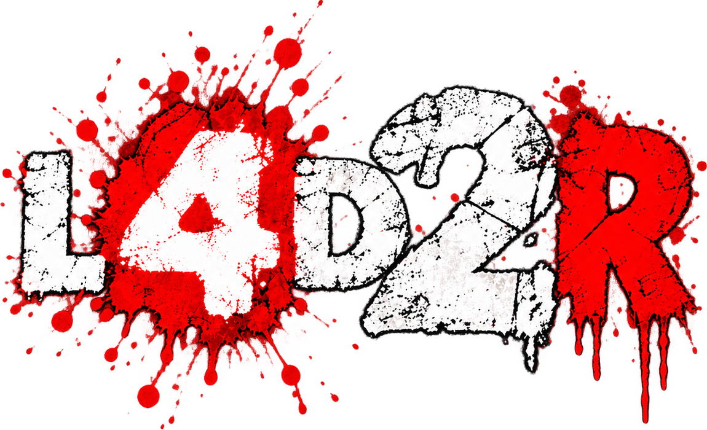

<p align="center">
  
</p>

<p align="center">
  <b>Left 4 Dead 2, rebuilt from scratch in Rust, for PC and iPhone.</b><br>
  <sub>Early testing · about 70% of the way to matching the original game</sub>
</p>

---

## About the project

L4D2R is a ground-up rewrite of Left 4 Dead 2's game engine. It's written in Rust on the [Bevy](https://bevyengine.org/) engine, not built on Valve's Source engine. It reads the original maps, models, textures, sounds and scripts straight from **your own copy of Left 4 Dead 2**, and plays them on new code. Nothing from Valve is bundled with it.

The goal is a 1:1 match with the original: the same AI Director, the same special infected behaviour, the same weapons, music and sound mixing. Each system is checked against the real game by:
- comparing numbers with the game's own settings and code;
- comparing side-by-side screenshots and recordings at the same spot.

Because the engine is new, the game also runs where Left 4 Dead 2 never did. There is an **iPhone version** with touch controls, and an iPhone and a PC can play together over the same Wi-Fi.

> L4D2R is a fan project. It is not made, endorsed or supported by Valve. You need to own Left 4 Dead 2 on Steam to play.

> [!WARNING]
> **Everything is a work in progress.** Expect bugs, missing features and crashes. As the project moves closer to a full 1:1 match, things will keep changing: weapons, AI, lighting, sound and menus may look, sound or feel slightly different from one build to the next, and from the original game.

## Progress

| Area | Progress | |
| --- | --- | --- |
| Director (pacing, hordes, specials, bosses, finales) | 83% | `████████░░` |
| Audio (sound, reverb, music, dialogue) | 82% | `████████░░` |
| Engine core (maps, assets, collision, map logic) | 80% | `████████░░` |
| Survivors (movement, weapons, items, bots) | 75% | `███████░░░` |
| Menus and HUD | 69% | `██████░░░░` |
| Rendering (lighting, particles, gore, glows) | 61% | `██████░░░░` |
| Game modes (campaign, survival, versus, scavenge) | 56% | `█████░░░░░` |
| Infected (commons, specials, Tank, Witch) | 55% | `█████░░░░░` |
| Physics (props, ragdolls) | 50% | `█████░░░░░` |
| Multiplayer | 50% | `█████░░░░░` |
| **Overall** | **≈70%** | `███████░░░` |

Each system counts as matched (100%), working but approximate (50%) or missing (0%). The percentage measures closeness to the original, not playability. Most of the game is already playable from start to finish.

### Done

- All 14 campaigns load and play through, including every finale and its rescue.
- The AI Director: pacing, intensity, hordes, panic events, special-infected timers and Tank/Witch placement, ported from the original game's code.
- Survivor bots that fight, heal, revive, pick up items and follow you.
- All six special infected, the Tank (rock throws, punches) and the Witch (sitting, wandering and the bride).
- Common infected with uncommon types, door breaking, dismemberment and blood.
- Weapons, melee, throwables (pipe bomb, molotov, bile jar), medkits, pills, adrenaline and defibrillators.
- Incapacitation, ledge hangs and black-and-white.
- Sound: original sound scripts, distance falloff, occlusion and automatic room reverb.
- Music: Tank, Witch, horde drums, grabs, downed, death, safe room and finale music.
- Character dialogue from the original response rules.
- Survival mode with timer and medals.
- Main menu, options, lobby, chat, scoreboard and HUD.
- Local and LAN multiplayer, including iPhone ↔ PC.
- iPhone: touch controls, an adjustable HUD, and in-app Steam sign-in to download your game files.

### Still to do

- Versus and Scavenge modes, and infected players over the network.
- Smarter special-infected AI (they use the original numbers but simpler decisions).
- The Tank hitting cars and other props, and the Witch's headshot stumble.
- Original physics engine behaviour for props and ragdolls (currently a close reconstruction).
- Colour correction, the flashlight's projected texture and full model lighting.
- Weapon spread patterns, recoil and bullet penetration.
- Lag compensation and client prediction for online play.
- Rescue closets (respawning dead teammates), save and resume, and fuller mutation support.
- Phone memory use on the largest maps.

## Install

### Windows PC

1. Install Left 4 Dead 2 through Steam.
2. Install the [Rust toolchain](https://rustup.rs/) and the Visual Studio C++ Build Tools (with a Windows SDK).
3. Download this repository (**Code → Download ZIP**, or `git clone`).
4. Build the launcher once:
   ```powershell
   powershell -ExecutionPolicy Bypass -File tools/build-launcher.ps1
   ```
5. Open **L4D2R Launcher.exe** and pick your Left 4 Dead 2 folder. Choose your video settings and press **Build & Play**. The first build takes several minutes; after that, **Play** starts the game straight away.

Your installed game is never modified. More detail is in [launcher/README.md](launcher/README.md).

### iPhone

1. Download `L4D2Rewrite.ipa` from the latest successful **Build iOS IPA** run on the [Actions](../../actions/workflows/ios.yml) page (under *Artifacts*).
2. Install it with [Sideloadly](https://sideloadly.io/) or [AltStore](https://altstore.io/) using your Apple ID.
3. Open the app, tap **Sign in with Steam** and download the starter pack. Your account must own Left 4 Dead 2. You can also copy a PC install's game folders into *Files → On My iPhone → L4D2 Rewrite → Left 4 Dead 2*.
4. Close and reopen the app once the download finishes.

Tip: a **render scale** of 2 (in the touch settings) runs much faster and uses far less memory than 3.

## Reporting bugs

Open an [issue](../../issues) with what you did, what you expected and what happened. Screenshots help a lot.

On iPhone, please attach `l4d2r-log-previous.txt` from *Files → On My iPhone → L4D2 Rewrite*. It's the log of your last session, including any crash. On PC, attach `runtime/launcher-build.log` for build problems.

## For developers

- [ios/README.md](ios/README.md) and [mobile/steam-installer/README.md](mobile/steam-installer/README.md): iPhone build and Steam downloads.

Run the tests with `cargo test --offline --release --bin l4d2-rewrite`.

## License

L4D2R's source code is licensed under the [Apache License 2.0](LICENSE). See also [NOTICE](NOTICE).

Third-party components keep their own licences: see [THIRD_PARTY_NOTICES.txt](THIRD_PARTY_NOTICES.txt) and [docs/L4D2R_INTEGRATION.md](docs/L4D2R_INTEGRATION.md). Left 4 Dead 2 and its game content belong to Valve and are not covered by this licence.
